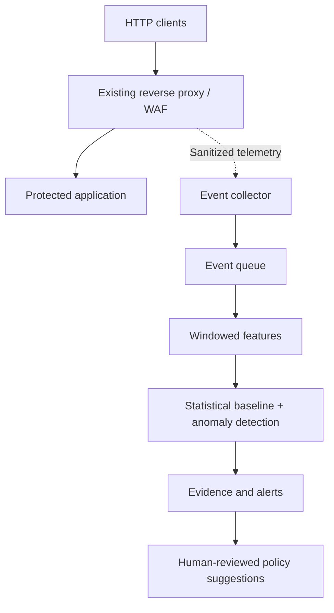

# Mendes Shield

**Adaptive security. Explainable intelligence. Open by design.**

Mendes Shield is an **early-stage research and engineering project** exploring behavioral anomaly detection for HTTP applications and APIs. Its long-term goal is to combine privacy-aware telemetry, statistical baselines, machine learning, and human-approved mitigation recommendations that complement existing WAFs.

> **Status: Foundation only.** This repository contains a minimal API skeleton, not a working threat detector, WAF or DDoS protection. **Do not use it as a production security control.**

## Principles

- **Shadow mode first:** observe before enforcing.
- **Human-in-the-loop:** no autonomous blocking in the MVP.
- **Decoupled data plane:** model availability cannot affect the application's HTTP serving path.
- **Privacy by default:** do not ingest credentials, tokens, cookies or request bodies.
- **Explainability and reproducibility:** publish honest evaluation evidence, including false positives.
- **Cloud agnostic and CPU first:** self-hostable, modest local development footprint.

## Architecture (planned)



The architecture and roadmap are proposals; they do not describe completed functionality.

## Local development (foundation only)

Prerequisites: Python 3.12+ and [uv](https://docs.astral.sh/uv/).

```bash
uv sync --dev
uv run uvicorn mendes_shield.main:app --reload
```

Visit `http://127.0.0.1:8000/health` and `http://127.0.0.1:8000/ready`. API docs at `/docs`. These are infrastructure checks, **not** signs of detection capability.

Or run the foundation in Docker:

```bash
docker compose up --build
```

No PostgreSQL, Redis or ML workers are required at this stage; they will be introduced only when their implementations exist.

## Quality gates

```bash
uv run pytest
uv run ruff check .
uv run mypy src
```

These commands are intended development checks, not proof of security effectiveness.

## Security and responsible disclosure

There is no supported production release. Do not post exploitable details or secrets in public Issues. Use GitHub Private Vulnerability Reporting if enabled; otherwise, ask the maintainer for a private reporting channel without posting exploit material. Only test systems you own or are explicitly authorized to assess. No security response SLA is promised.

## Contributing and governance

Code contributions are paused until the project license and contributor terms are approved. Documentation feedback, threat-model suggestions and design discussions are welcome through GitHub Issues. Mendes Tech is the initial maintainer; the project owner makes final decisions on releases, licensing, architecture and security disclosures. Substantial technical decisions should be recorded as ADRs after discussion. No security assurance or release certification is implied.

## License

**License not yet selected.** AGPL-3.0 is under consideration. Until an explicit LICENSE is published, the source code is publicly visible but not licensed for unrestricted reuse or redistribution. External code contributions are on hold pending the licensing decision.

---

Maintained by **Mendes Tech**. Independent project; not affiliated with Google or Google Cloud Armor.
