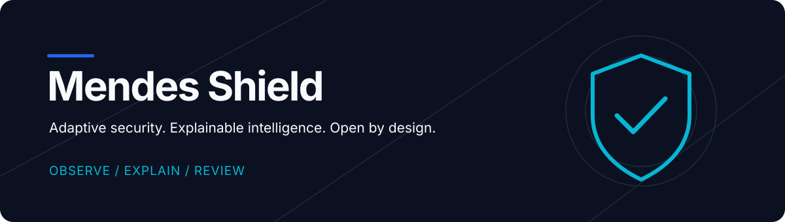
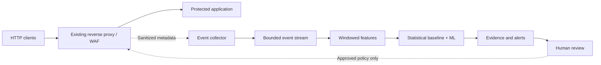

# Mendes Shield

<p align="center">
  
</p>

<p align="center"><strong>Adaptive security. Explainable intelligence. Open by design.</strong></p>

<p align="center">
  <a href="README.pt-BR.md">Português (Brasil)</a> ·
  <a href="docs/architecture/README.md">Architecture</a> ·
  <a href="docs/getting-started/README.md">Getting started</a> ·
  <a href="docs/roadmap.md">Roadmap</a> ·
  <a href="CONTRIBUTING.md">Contributing</a> ·
  <a href="SECURITY.md">Security</a>
</p>

<p align="center">
  <a href="https://github.com/ErikaMendes89/mendes-shield/actions/workflows/ci.yml"></a>
  
  
  
  
</p>

Mendes Shield is an early-stage cybersecurity research and engineering project exploring explainable behavioral anomaly detection for HTTP applications and APIs. It aims to complement existing WAFs with privacy-aware telemetry and human-reviewed signals. The project is source-available; its license has not been approved, so the public repository does not grant general reuse rights.

> [!IMPORTANT]
> **Foundation only.** The repository currently provides a minimal FastAPI service with health and readiness endpoints. It does not implement anomaly detection, telemetry ingestion, WAF integration, or DDoS mitigation. Do not use it as a production security control.

## Current capabilities

| Capability | Status |
| --- | --- |
| FastAPI health and readiness endpoints | Implemented |
| OpenAPI documentation | Implemented |
| Local development, Docker Compose, and CI checks | Implemented |
| Privacy-aware HTTP event ingestion | Planned |
| Time-window feature extraction and anomaly detection | Planned |
| Evidence-backed alerts and reviewed policy recommendations | Planned |
| WAF adapters and operational dashboard | Planned |

Planned items are goals, not shipped functionality. See the [public roadmap](docs/roadmap.md).

## Architecture proposal

The current API is independent of the proposed analytics pipeline below. The diagram describes a future design, not deployed components.



The design keeps analytics asynchronous and fail-isolated from the protected request path. It defaults to observation, minimizes personal data, and does not enable autonomous blocking. Read the [architecture overview](docs/architecture/README.md), [security design](docs/security/README.md), and [ML evaluation principles](docs/machine-learning/README.md).

## Quick start

Requires Python 3.12+ and [uv](https://docs.astral.sh/uv/).

```bash
git clone https://github.com/ErikaMendes89/mendes-shield.git
cd mendes-shield
uv sync --dev
uv run uvicorn mendes_shield.main:app --reload
```

Check `http://127.0.0.1:8000/health`, `/ready`, or `/docs`. These endpoints confirm that the foundation API is serving; they do not indicate security detection capability.

To run the same foundation in Docker:

```bash
docker compose up --build
```

Development checks:

```bash
uv run pytest
uv run ruff check .
uv run mypy src
```

See the [getting started guide](docs/getting-started/README.md) for setup details.

## Contributing and project governance

Code contributions are paused until the project license and contributor terms are approved. Design discussions, threat-model feedback, and documentation suggestions are welcome through GitHub Issues. Read [CONTRIBUTING.md](CONTRIBUTING.md), the [governance policy](GOVERNANCE.md), and the [Code of Conduct](CODE_OF_CONDUCT.md) before participating.

## Security

There is no supported production release or security response SLA. Do not publish vulnerability details, credentials, or private telemetry in public issues. Follow [SECURITY.md](SECURITY.md) for responsible disclosure guidance.

## License

**Pending owner approval.** AGPL-3.0 is under evaluation. No license file has been published, and visibility of this source code does not grant general permission to reuse, modify, or redistribute it.

---

Maintained by **Mendes Tech**. Independent project; not affiliated with Google or Google Cloud Armor.
