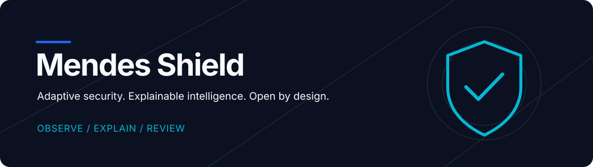
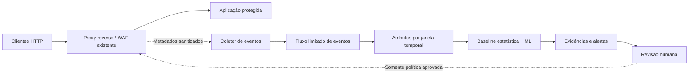

# Mendes Shield

<p align="center">
  
</p>

<p align="center"><strong>Adaptive security. Explainable intelligence. Open by design.</strong></p>
<p align="center">Segurança adaptativa. Inteligência explicável. Aberto por princípio.</p>

<p align="center">
  <a href="README.md">English</a> ·
  <a href="docs/architecture/README.md">Arquitetura</a> ·
  <a href="docs/getting-started/README.md">Primeiros passos</a> ·
  <a href="docs/roadmap.md">Roadmap</a> ·
  <a href="CONTRIBUTING.md">Contribuição</a> ·
  <a href="SECURITY.md">Segurança</a>
</p>

<p align="center">
  <a href="https://github.com/ErikaMendes89/mendes-shield/actions/workflows/ci.yml"></a>
  
  
  
  
</p>

O Mendes Shield é um projeto inicial de pesquisa e engenharia em cibersegurança que investiga detecção comportamental explicável de anomalias em aplicações HTTP e APIs. A proposta é complementar WAFs existentes com telemetria que preserve a privacidade e sinais revisados por pessoas. O código está publicamente visível, mas a licença ainda não foi aprovada; a publicação não concede direitos gerais de reutilização.

> [!IMPORTANT]
> **Somente fundação.** O repositório oferece uma API FastAPI mínima com endpoints de saúde e prontidão. Ainda não implementa detecção de anomalias, ingestão de telemetria, integração com WAF ou mitigação de DDoS. Não utilize como controle de segurança em produção.

## Funcionalidades atuais

| Capacidade | Situação |
| --- | --- |
| Endpoints de saúde e prontidão em FastAPI | Implementados |
| Documentação OpenAPI | Implementada |
| Desenvolvimento local, Docker Compose e verificações de CI | Implementados |
| Ingestão de eventos HTTP com privacidade | Planejada |
| Extração de atributos temporais e detecção de anomalias | Planejadas |
| Alertas com evidências e recomendações revisadas por pessoas | Planejados |
| Adaptadores para WAF e painel operacional | Planejados |

Itens planejados são objetivos, não funcionalidades entregues. Consulte o [roadmap público](docs/roadmap.md).

## Proposta de arquitetura

A API atual é independente do pipeline analítico proposto abaixo. O diagrama descreve uma direção futura, não componentes implantados.



O desenho mantém a análise assíncrona e isolada de falhas da rota de requisições protegida. O padrão é observação, minimização de dados pessoais e ausência de bloqueio autônomo. Consulte a [visão de arquitetura](docs/architecture/README.md), o [projeto de segurança](docs/security/README.md) e os [princípios de avaliação de ML](docs/machine-learning/README.md).

## Início rápido

Requisitos: Python 3.12+ e [uv](https://docs.astral.sh/uv/).

```bash
git clone https://github.com/ErikaMendes89/mendes-shield.git
cd mendes-shield
uv sync --dev
uv run uvicorn mendes_shield.main:app --reload
```

Acesse `http://127.0.0.1:8000/health`, `/ready` ou `/docs`. Esses endpoints confirmam que a API de fundação está servindo; não indicam capacidade de detectar ameaças.

Para executar a fundação em Docker:

```bash
docker compose up --build
```

Verificações de desenvolvimento:

```bash
uv run pytest
uv run ruff check .
uv run mypy src
```

Consulte o guia de [primeiros passos](docs/getting-started/README.md) para detalhes.

## Contribuição e governança

Contribuições de código estão pausadas até a aprovação da licença e dos termos para contribuidores. Discussões de design, comentários sobre o modelo de ameaças e sugestões de documentação são bem-vindos nas GitHub Issues. Leia [CONTRIBUTING.md](CONTRIBUTING.md), a [governança](GOVERNANCE.md) e o [Código de Conduta](CODE_OF_CONDUCT.md) antes de participar.

## Segurança

Não há versão de produção suportada nem SLA de resposta a incidentes. Não publique detalhes de vulnerabilidades, credenciais ou telemetria privada em issues públicas. Consulte [SECURITY.md](SECURITY.md) para orientações de divulgação responsável.

## Licença

**Pendente de aprovação da proprietária.** A AGPL-3.0 está em avaliação. Nenhum arquivo de licença foi publicado; a visibilidade do código não concede permissão geral para reutilizá-lo, modificá-lo ou redistribuí-lo.

---

Mantido pela **Mendes Tech**. Projeto independente, sem afiliação ao Google ou ao Google Cloud Armor.
