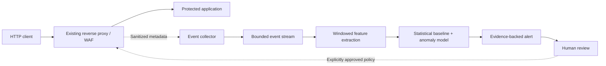

# Architecture

[Home](../../README.md) · [Roadmap](../roadmap.md) · [Security](../security/README.md) · [ML design](../machine-learning/README.md) · [ADRs](../adr/README.md)

## Current implementation

The current application is a small FastAPI service with `/health` and `/ready` endpoints. It has no telemetry ingestion, database, queue, model, WAF adapter, or mitigation capability. The proposal below is not an implementation inventory.

## Proposed system

## Design constraints

1. Keep model inference out of the synchronous serving request path.
2. Failure of analytics must not disable the existing WAF or disrupt protected requests.
3. Default to observation. A model signal alone must never cause production blocking.
4. Separate transport, domain logic, feature engineering, model inference, and policy control.
5. Minimize collected data. Credentials, cookies, tokens, and request bodies are excluded by default.
6. Bound event sizes, queue capacity, and processing budgets; preserve idempotency and auditability.
7. Compare anomaly models with a documented statistical baseline and report false positives.
8. Run security simulations only against owned or explicitly authorized systems.

## Candidate components

Python and FastAPI are used for the current API. PostgreSQL, Redis Streams, scikit-learn, proxy adapters, and a dashboard remain candidates for later phases. Select integrations through owner-reviewed ADRs before implementation; see the [ADR index](../adr/README.md).

## Trust boundaries

The existing WAF remains authoritative for inline enforcement. Telemetry is untrusted input. Models and training data are separate trust domains. An anomaly score is a signal for review, not proof of malicious behavior.
